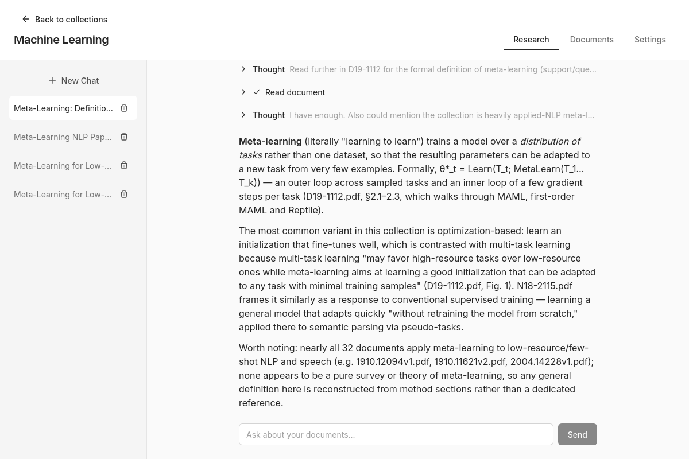

# Insight

**Local-first document research for journalists.**



Insight lets you build collections of PDFs, ask questions in plain language, and receive answers with citations. Documents and search indexes stay on your computer. Collections can sync directly between colleagues, and you choose the AI provider used for chat.

## Project status

Insight is a research project exploring AI-assisted document research, peer-to-peer collaboration, and local-first tools for journalism. It is not production-ready.

## Development

### Prerequisites

- [Rust](https://rustup.rs/) (stable)
- [Node.js](https://nodejs.org/) 20 or newer
- [pnpm](https://pnpm.io/)
- [Tauri's platform prerequisites](https://v2.tauri.app/start/prerequisites/)
- libclang for `mupdf-sys`'s bindgen step (`clang` on Arch, `libclang-dev` and `clang` on Debian/Ubuntu, Xcode Command Line Tools on macOS, or LLVM on Windows)

### Run and build

```bash
pnpm install
pnpm tauri dev           # Desktop app with hot reload
pnpm tauri build         # Release build
```

For a development build, use `pnpm tauri build --debug`.

### Checks

```bash
pnpm test:run
pnpm check
pnpm lint

cd src-tauri
cargo test --workspace
cargo clippy --workspace --all-targets
cargo fmt --all --check
```
